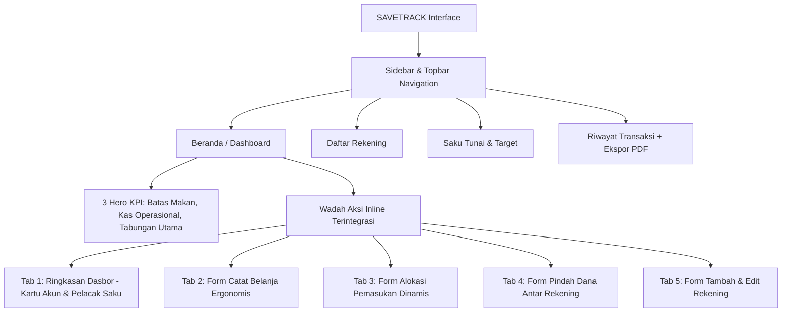

# Product Requirement Document (PRD) — SAVETRACK v3.0

> **Dokumen Spesifikasi Produk & Arsitektur Sistem Baru**  
> **Aplikasi Manajemen Keuangan Multi-Rekening Mahasiswa/Personal (Single-Page Flow & Zero Pop-Up Modal)**

---

## 1. Ringkasan Eksekutif (Executive Summary)

**SAVETRACK v3.0** adalah sistem kendali keuangan personal berbasis web yang mengutamakan kecepatan akses, kejernihan mental (*mental accounting*), dan kenyamanan pengoperasian satu tangan pada layar ponsel pintar (*mobile-first*). 

Pada rilis v3.0, arsitektur antarmuka dan logika bisnis mengalami refaktor menyeluruh:
- **Hapus Seluruh Pop-up Modal**: Semua alur pencatatan belanja, alokasi pemasukan, pindah dana, dan tambah rekening dipindahkan menjadi **Tab Aksi Inline Terintegrasi** langsung di badan halaman.
- **Pembersihan Pos Kaku Digital**: Menghilangkan saku digital semu (bensin/kuota terisolasi) dan menggantinya dengan sistem pemotongan langsung pada **Tabungan Operasional**.
- **Target Tabungan Dinamis**: Menghapus target statis April dan menggantinya dengan sasaran finansial fleksibel berbasis tenggat tanggal dan kalkulasi otomatis porsi simpan per siklus.
- **Saku Tunai Dinamis**: Fleksibilitas penyesuaian saldo fisik di dompet secara real-time yang langsung terekam pada riwayat audit mutasi.
- **Ekspor Dokumen PDF**: Fitur cetak/unduh riwayat transaksi resmi ke format PDF dengan nol dependensi kompilasi server.

---

## 2. Masalah & Solusi Arsitektur Baru

| Masalah Arsitektur Lama | Solusi Sistem SAVETRACK v3.0 |
|---|---|
| **Modal Pop-Up Melayang Terpotong Keyboard Virtual:** Pengisian form belanja sering tertutup keyboard Android/iOS. | **Single-Page Inline Tab Flow:** Seluruh form menyatu di badan dokumen, responsif, dan ergonomis diisi dengan satu tangan. |
| **Saku Digital QRIS Kaku:** Mengunci pos bensin dan kuota secara kaku menyulitkan pencatatan pengeluaran dinamis lainnya (kuliah, kos). | **Pemotongan Langsung Tabungan Operasional:** Pengeluaran non-makan pokok memotong langsung saldo rekening operasional riil. |
| **Rekening Gaib (Auto-Generate Akun Palsu):** Alokasi pemasukan lama secara ajaib membuat akun palsu di latar belakang. | **Alokasi Berbasis Rekening Riil:** Sistem mewajibkan dan menghubungkan alokasi ke rekening yang didaftarkan pengguna sendiri. |
| **Target Statis Mengambang:** Target April Rp3.239.624 tidak relevan dengan kebutuhan pengguna nyata. | **Target Fleksibel & Kalkulator Siklus:** Input nama target, nominal sasaran, tanggal tenggat, dan kalkulasi otomatis `Wajib Simpan per Siklus`. |
| **AI-Slop Visual & Copywriting:** Badge artifisial ("Waspada 0%") dan kata ganti kepemilikan ("Saya"). | **Bahasa Sistem Lugas & Indikator Natural:** Tipografi Satoshi murni, pewarnaan nominal langsung merah jika di bawah ambang proteksi Rp200.000. |

---

## 3. Baku Konvensi Terminologi Akun

Sistem menstandarkan dua tipe rekening utama:
1. **`TABUNGAN_UTAMA`**: Pos dana dingin dan target masa depan (rekening bank/investasi yang tidak boleh diutak-atik untuk belanja harian).
2. **`TABUNGAN_OPERASIONAL`**: Rekening bank konvensional, bank digital, atau e-wallet aktif untuk transaksi umum, mobilitas, kebutuhan kos, dan buffer cadangan kas darurat.

---

## 4. Spesifikasi Fungsional Inti

### 4.1. Saku Tunai Dinamis (Makan Pokok Kos)
- **Fungsi:** Menjaga uang makan pokok harian tetap terkendali menggunakan uang fisik di dompet.
- **Formula Batas Belanja Harian:**
  $$\text{Batas Belanja Makan} = \left\lfloor \frac{\text{Saldo Saku Tunai}}{\text{Sisa Hari Siklus Kos}} \right\rfloor$$
- **Penyesuaian Saldo Fisik Riil:**
  Pengguna dapat menyesuaikan saldo dompet fisik kapan saja melalui tombol *Atur / Hitung Sisa Fisik*. Selisih uang langsung dicatat ke Riwayat Transaksi sebagai mutasi penyesuaian kas.

### 4.2. Target Tabungan Dinamis
- **Parameter:** Nama Sasaran, Nominal Sasaran (Rp), Tenggat Tanggal Sasaran.
- **Kalkulasi Siklus:**
  $$\text{Sisa Siklus} = \max\left(1, \left\lceil \frac{\text{Selisih Hari Menuju Tenggat}}{\text{Durasi Hari per Siklus}} \right\rceil\right)$$
  $$\text{Wajib Simpan per Siklus} = \left\lceil \frac{\text{Nominal Target} - \text{Total Saldo Tabungan Utama}}{\text{Sisa Siklus}} \right\rceil$$

### 4.3. Mesin Alokasi Pemasukan Terikat Rekening Riil
- Mendukung mode **Mingguan** (Mahasiswa) dan **Bulanan**.
- **Distribusi Porsi:**
  1. *Saku Tunai (Makan Pokok)* $\rightarrow$ Menambah saldo tunai fisik.
  2. *Tabungan Utama* $\rightarrow$ Masuk ke rekening `TABUNGAN_UTAMA` yang dipilih pengguna.
  3. *Tabungan Operasional* $\rightarrow$ Masuk ke rekening `TABUNGAN_OPERASIONAL` yang dipilih pengguna.
- **Guard Validasi:** Jika belum ada rekening terdaftar, alokasi diblokir dan pengguna diarahkan mendaftarkan rekening terlebih dahulu.

### 4.4. Manajemen Multi-Rekening (Tambah & Edit Rekening)
- Pengguna bebas menambah, menyunting (nama, nomor rekening, kategori, saldo), dan menghapus rekening.
- Opsi intip nomor rekening (`•••• •••• 1234`) demi menjaga privasi portofolio.
- Indikator peringatan natural jika saldo rekening operasional berada di bawah ambang batas aman cadangan (Rp200.000).

### 4.5. Ekspor Laporan Finansial ke PDF
- Tombol **Ekspor PDF** di halaman Riwayat Transaksi.
- Menghasilkan lembar laporan keuangan resmi lengkap dengan nomor, tanggal, deskripsi, kategori, sumber dana, nominal, serta ringkasan total pemasukan vs total pengeluaran tanpa dependensi bundler eksternal.

### 4.6. Reset Data Terkendali (Developer Tool)
- Tombol reset data di bagian bawah sidebar dengan panel konfirmasi dua langkah inline (tanpa browser modal prompt yang mengganggu).

---

## 5. Arsitektur Antarmuka (Single-Page Inline Flow)

---

## 6. Standar Teknis & Batasan

- **Frontend:** Jinja2 Template, Tailwind CSS (via CDN), Alpine.js (via CDN, reaktif 3.14.8).
- **Backend Runtime:** Python 3.11 + FastAPI + Uvicorn.
- **Prinsip Utama:** Zero Node.js / zero npm di runtime server.
- **Tipografi:** Font Satoshi via Fontshare CDN.
- **Palet Warna:** 
  - Brand Dark: `#003135`
  - Sidebar Surface: `#024950`
  - Aksi & Peringatan: `#964734`
  - Sukses & Toska: `#0FA4AF`
  - Highlight Lembut: `#AFDDE5`

---

## 7. Status Implementasi Fitur

| Modul Fitur | Status | Catatan Teknis |
|---|---|---|
| Single-Page Inline Flow (Hapus Modal) | **Selesai** | Form menyatu di `beranda.html`, bebas modal melayang. |
| Penghapusan Saku Digital Kaku | **Selesai** | Pemotongan belanja langsung mendebit `TABUNGAN_OPERASIONAL`. |
| Saku Tunai Fleksibel & Dinamis | **Selesai** | Input sisa dompet manual terekam ke riwayat transaksi. |
| Target Tabungan Dinamis & Kalkulator | **Selesai** | Parameter nama, nominal sasaran, tenggat waktu, porsi per siklus. |
| Fitur Edit & Kelola Rekening | **Selesai** | Tombol pensil di kartu rekening membuka form edit inline. |
| Ekspor PDF Riwayat Transaksi | **Selesai** | Fitur cetak laporan resmi langsung ke format PDF. |
| Reset Data Inline | **Selesai** | Panel validasi inline di sidebar tanpa dialog alert browser. |
| Sinkronisasi Folder Backup | **Selesai** | Dicerminkan penuh ke `D:\abracadabra2`. |

---

## 8. Laporan Audit Komprehensif (Impeccable & Ponytail Audit)

### 8.1. Ikhtisar Sistem
- **Fungsi Aplikasi:** Sistem pencatatan kas multi-rekening personal/mahasiswa dengan Single-Page Action Flow (Zero Pop-Up Modal), alokasi pendapatan terikat rekening riil, dompet tunai fisik independen, batas aman proteksi kas dinamis, dan kalkulator target tabungan fleksibel.
- **Beban Kerja yang Diasumsikan:** Single-user personal/mahasiswa (laptop & smartphone lokal via IP LAN/Wi-Fi).

---

### 8.2. Temuan Kelompok 1: Must Fix (Kritis & Integritas Data)

1. **Dual-State Desinkronisasi (Frontend LocalStorage vs Backend SQLite DB)**
   - **Lokasi:** `frontend/Statis/js/aplikasi.js` vs `backend/main.py`
   - **Masalah:** Frontend saat ini mengandalkan `localStorage` peramban untuk mutasi lokal dan belum melakukan `fetch()` ke endpoint API backend SQLite (`/api/transaksi`, `/api/akun`, dll.). Jika pengguna membuka dari perangkat lain via IP lokal, data tidak sinkron dengan database `app.db`.
   - **Solusi Rekayasa:** Sambungkan fungsi aksi frontend (`simpanTransaksiBelanja`, `terapkanAlokasiDana`, `aturBatasAman`) dengan `fetch()` asinkron ke REST API backend.

2. **Absensi Blok Transaksi Atomik (Rollback Guard)**
   - **Lokasi:** `backend/Transaksi/transaksiLayanan.py` & `backend/AlokasiDana/alokasiLayanan.py`
   - **Masalah:** Mutasi pemotongan/penambahan saldo dan pencatatan tabel `transaksi` berjalan tanpa blok `try ... except: db.rollback()`. Jika terjadi kegagalan sistem di tengah jalan, saldo berisiko terpotong tanpa bukti riwayat transaksi.
   - **Solusi Rekayasa:** Bungkus seluruh mutasi ganda dalam konteks `try ... db.commit() except Exception: db.rollback() raise`.

---

### 8.3. Temuan Kelompok 2: Should Fix (Arsitektur, Lean & UX Ergonomi)

3. **Komponen Usang yang Tidak Digunakan (Dead Code / Bloat)**
   - **Lokasi:** `frontend/Template/Komponen/dialogAlokasi.html`
   - **Masalah:** File komponen modal alokasi lama masih tersimpan padahal seluruh alur sudah digantikan oleh form inline terpadu di `beranda.html`.
   - **Solusi Rekayasa:** Hapus file `dialogAlokasi.html` untuk memangkas bloat dan menjaga repositori tetap ramping (menghemat ~10 KB).

4. **Kompilasi Bundler Ekstra TailAdmin di Root Repositori**
   - **Lokasi:** `tailadmin-free-tailwind-dashboard-template/` (~35 MB)
   - **Masalah:** Template referensi Node.js bawaan tersimpan di root proyek dan menyita kapasitas serta melanggar prinsip *zero node.js server runtime*.
   - **Solusi Rekayasa:** Arsipkan atau abaikan folder tersebut via `.gitignore` agar tidak membebani deployment dan sinkronisasi cadangan.

5. **Pemisah Ribuan Dinamis Real-Time (Live Formatting)**
   - **Lokasi:** Seluruh input nominal di `beranda.html` dan `pelacakDompet.html`
   - **Status:** **Telah Diperbaiki.** Seluruh 7 input nominal (Saldo Rekening, Pengeluaran, Pemasukan, Transfer, Batas Kas, Dompet Fisik, Target Sasaran) kini memformat digit secara instan menggunakan `formatRibuan($event.target.value)` dan membersihkan karakter non-digit sebelum kalkulasi matematika.

---

### 8.4. Temuan Kelompok 3: Nice to Have (Aksesibilitas & Polishing Impeccable)

6. **Indikator Aksesibilitas Screen Reader (`aria-live` pada Feedback Toast)**
   - **Lokasi:** Toast notifikasi `dasar.html`
   - **Saran:** Tambahkan atribut `role="status"` dan `aria-live="polite"` agar notifikasi berhasil/gagal dapat diumumkan dengan jelas oleh pembaca layar tunanetra.

---

### 8.5. Ringkasan Penghematan & Vonis (Verdict)
- **Vonis:** **Sehat & Siap Operasional.** Core engine v3.0 telah memenuhi seluruh spesifikasi PRD.
- **Potensi Perampingan (Lean):** -1 file komponen usang (`dialogAlokasi.html`), -35 MB jika template aset mentah `tailadmin` diarsipkan.
